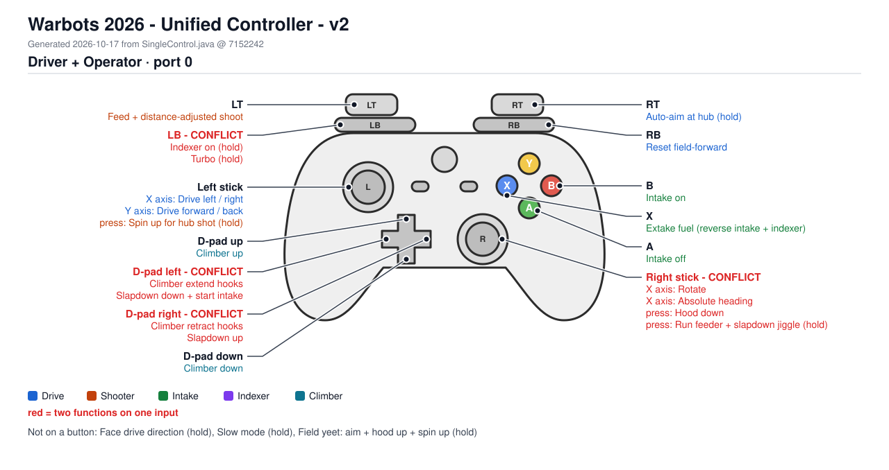
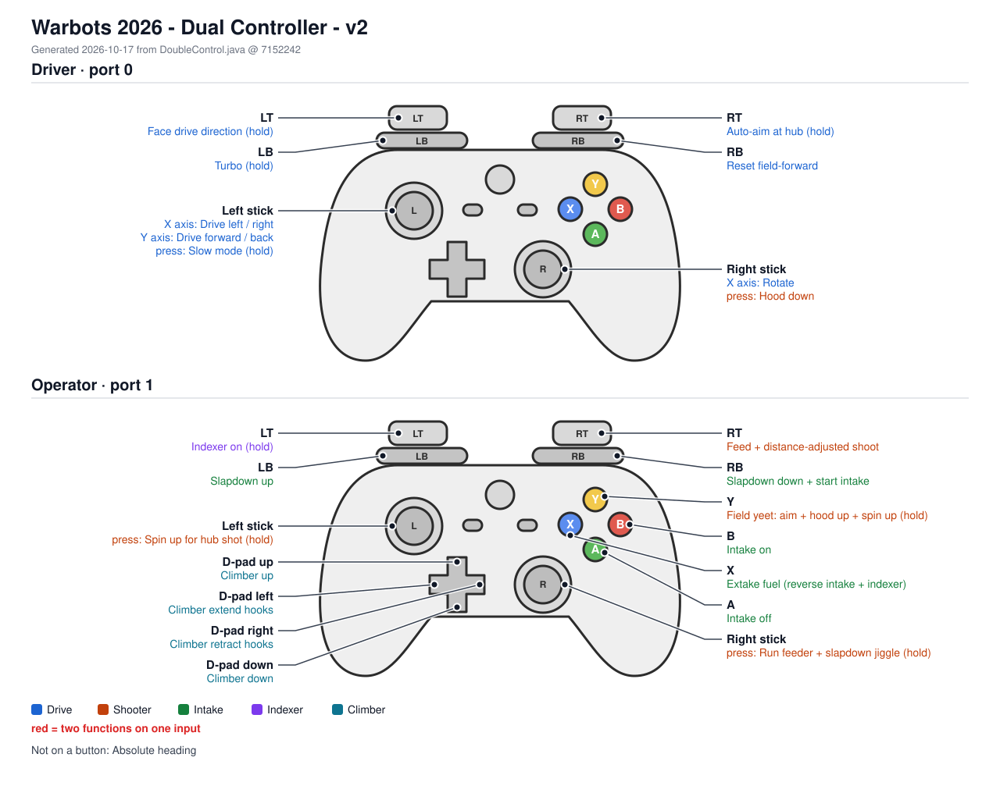

# Controller Diagrams - MASTER

> Generated by `docs/controls/tools/ControlDiagramGenerator.java`. Do not edit by hand; run `./gradlew controlDiagrams` instead. See [README](README_CONTROLLER-LAYOUT.md).

- [Unified Controller](#unified-controller)
- [Dual Controller](#dual-controller)

## Unified Controller

**Current: v2** (2026-10-17, commit `7152242`) from `src/main/java/org/jmhsrobotics/frc2026/controlBoard/SingleControl.java`

Human check: **not yet checked**

#### Driver + Operator (port 0, `driver`, image `xbox/v1`)

| Input | Robot function | Group | Status |
|---|---|---|---|
| Left stick (X axis) | Drive left / right `translationX()` | Drive | ok |
| Left stick (Y axis) | Drive forward / back `translationY()` | Drive | ok |
| Left stick (press) | Spin up for hub shot (hold) `dutyCycleShoot()` | Shooter | ok |
| Right stick (X axis) | Rotate `rotation()` | Drive | **CONFLICT** |
| Right stick (X axis) | Absolute heading `rotationABS()` | Drive | **CONFLICT** |
| Right stick (press) | Hood down `hoodDown()` | Shooter | **CONFLICT** |
| Right stick (press) | Run feeder + slapdown jiggle (hold) `runFeeder()` | Shooter | **CONFLICT** |
| LT | Feed + distance-adjusted shoot `feedAndShoot()` | Shooter | ok |
| RT | Auto-aim at hub (hold) `autoAim()` | Drive | ok |
| LB | Indexer on (hold) `indexOn()` | Indexer | **CONFLICT** |
| LB | Turbo (hold) `turbo()` | Drive | **CONFLICT** |
| RB | Reset field-forward `resetForward()` | Drive | ok |
| A | Intake off `intakeOff()` | Intake | ok |
| B | Intake on `intakeOn()` | Intake | ok |
| X | Extake fuel (reverse intake + indexer) `extakeFuel()` | Intake | ok |
| D-pad up | Climber up `climberUp()` | Climber | ok |
| D-pad down | Climber down `climberDown()` | Climber | ok |
| D-pad left | Climber extend hooks `ClimberExtendHooks()` | Climber | **CONFLICT** |
| D-pad left | Slapdown down + start intake `slapdownMoveDown()` | Intake | **CONFLICT** |
| D-pad right | Climber retract hooks `ClimberRetractHooks()` | Climber | **CONFLICT** |
| D-pad right | Slapdown up `slapdownMoveUp()` | Intake | **CONFLICT** |

**Not on a button in this config:** Face drive direction (hold) `faceDriveDirection()`, Slow mode (hold) `slowdown()`, Field yeet: aim + hood up + spin up (hold) `fieldYeet()`

### Version history

| Version | Date | Commit | Note | Human check |
|---|---|---|---|---|
| [v2](diagrams/single/v2/diagram.svg) | 2026-10-17 | `7152242` | Diagrams now built from keybinding files only; unused-binding check moved to the review page | **not yet checked** |
| [v1](diagrams/single/v1/diagram.svg) | 2026-10-17 | `ca47baf` | Initial diagrams from current SingleControl/DoubleControl | **not yet checked** |

## Dual Controller

**Current: v2** (2026-10-17, commit `7152242`) from `src/main/java/org/jmhsrobotics/frc2026/controlBoard/DoubleControl.java`

Human check: **not yet checked**

#### Driver (port 0, `driver`, image `xbox/v1`)

| Input | Robot function | Group | Status |
|---|---|---|---|
| Left stick (X axis) | Drive left / right `translationX()` | Drive | ok |
| Left stick (Y axis) | Drive forward / back `translationY()` | Drive | ok |
| Left stick (press) | Slow mode (hold) `slowdown()` | Drive | ok |
| Right stick (X axis) | Rotate `rotation()` | Drive | ok |
| Right stick (press) | Hood down `hoodDown()` | Shooter | ok |
| LT | Face drive direction (hold) `faceDriveDirection()` | Drive | ok |
| RT | Auto-aim at hub (hold) `autoAim()` | Drive | ok |
| LB | Turbo (hold) `turbo()` | Drive | ok |
| RB | Reset field-forward `resetForward()` | Drive | ok |

#### Operator (port 1, `operator`, image `xbox/v1`)

| Input | Robot function | Group | Status |
|---|---|---|---|
| Left stick (press) | Spin up for hub shot (hold) `dutyCycleShoot()` | Shooter | ok |
| Right stick (press) | Run feeder + slapdown jiggle (hold) `runFeeder()` | Shooter | ok |
| LT | Indexer on (hold) `indexOn()` | Indexer | ok |
| RT | Feed + distance-adjusted shoot `feedAndShoot()` | Shooter | ok |
| LB | Slapdown up `slapdownMoveUp()` | Intake | ok |
| RB | Slapdown down + start intake `slapdownMoveDown()` | Intake | ok |
| A | Intake off `intakeOff()` | Intake | ok |
| B | Intake on `intakeOn()` | Intake | ok |
| X | Extake fuel (reverse intake + indexer) `extakeFuel()` | Intake | ok |
| Y | Field yeet: aim + hood up + spin up (hold) `fieldYeet()` | Shooter | ok |
| D-pad up | Climber up `climberUp()` | Climber | ok |
| D-pad down | Climber down `climberDown()` | Climber | ok |
| D-pad left | Climber extend hooks `ClimberExtendHooks()` | Climber | ok |
| D-pad right | Climber retract hooks `ClimberRetractHooks()` | Climber | ok |

**Not on a button in this config:** Absolute heading `rotationABS()`

### Version history

| Version | Date | Commit | Note | Human check |
|---|---|---|---|---|
| [v2](diagrams/dual/v2/diagram.svg) | 2026-10-17 | `7152242` | Diagrams now built from keybinding files only; unused-binding check moved to the review page | **not yet checked** |
| [v1](diagrams/dual/v1/diagram.svg) | 2026-10-17 | `ca47baf` | Initial diagrams from current SingleControl/DoubleControl | **not yet checked** |
